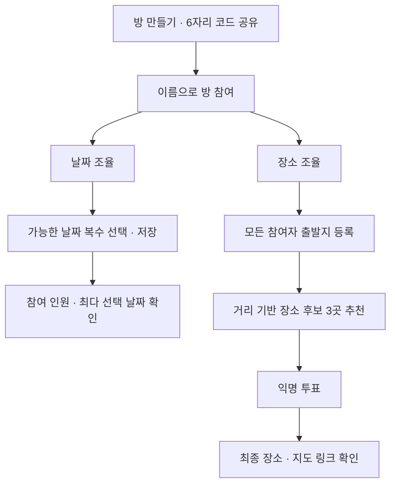
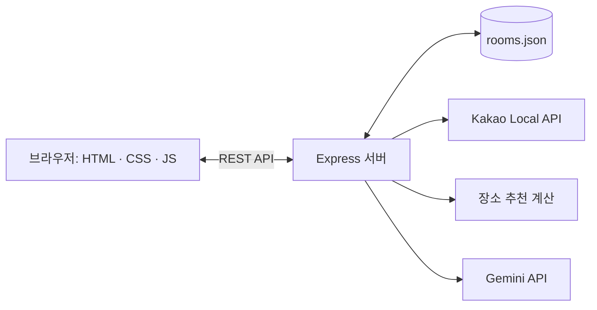

# 만날지도 (mannalZIDO)

**날짜부터 장소까지, 우리 약속을 한곳에서.**

친구·동아리·팀 모임처럼 여러 사람이 함께 만날 때, 가능한 날짜를 모으고 각자의 출발지를 고려해 만남 장소를 정하는 **웹 기반 약속 조율 서비스**입니다.

회원가입 없이 방을 만들고 초대 코드로 참여할 수 있습니다. 날짜별 참여 가능 인원을 확인하고, 장소 후보를 추천받아 익명 투표로 최종 만남 장소를 결정합니다.

[**GitHub**](https://github.com/bagjibin011-max/mannalZIDO) · [**Issues**](https://github.com/bagjibin011-max/mannalZIDO/issues)

---

## Why mannalZIDO?

여러 명이 약속을 잡을 때는 단체 채팅에서 가능한 날짜를 일일이 확인하고, 출발지가 다른 사람들의 이동 부담까지 고려해야 합니다.

메시지가 쌓이면 누가 언제 가능한지 놓치기 쉽고, 장소를 정할 때도 몇 사람의 의견에 의존하기 쉽습니다.

**만날지도**는 이 과정을 하나의 방으로 연결합니다. 모두가 직접 날짜를 선택하고, 출발지를 등록하고, 추천된 장소 후보에 투표할 수 있습니다.

---

## Core Experience



날짜 조율과 장소 조율은 같은 방에서 **각각 진행**할 수 있습니다. 장소 추천은 모든 참여자의 출발지가 등록되면 시작됩니다.

---

## Main Features

### Room — 방 생성과 참여

- 방 이름과 참여 인원을 지정하여 약속 방을 생성합니다.
- 중복을 피한 **6자리 초대 코드**를 발급합니다.
- 팀원은 별도 회원가입 없이 **초대 코드와 이름**으로 참여합니다.
- 방 화면에서 참여자 명단, 날짜·장소 진행 현황을 확인할 수 있습니다.
- 저장된 날짜·장소 조율 내역을 초기화할 수 있습니다. 방과 참여자 정보는 유지됩니다.

### Date — 가능한 날짜 조율

- 달력에서 가능한 날짜를 **여러 개 선택하고 저장**합니다.
- 날짜를 **다시 클릭하거나 오른쪽 목록의 × 버튼**으로 선택을 취소할 수 있습니다.
- 날짜별 저장된 선택 인원과 참여자 이름을 확인할 수 있습니다.
- **노란색 농도**로 현재 방 참여 인원 대비 날짜별 선택 비율을 보여줍니다.
- 가장 많은 사람이 선택한 날짜는 **★**로 표시합니다.
- 저장되지 않은 변경 사항은 **빨간 점**으로 구분합니다.
- 다른 참여자의 저장 결과를 **4초마다 자동 갱신**하며, 내 미저장 선택을 보존합니다.
- 저장 전 선택 초기화와 서버에 저장한 날짜 초기화를 지원합니다.

### Place — 출발지 기반 장소 추천

- **카카오 로컬 검색 API**로 장소 이름 또는 주소를 검색해 출발지를 등록합니다.
- 모든 참여자가 출발지를 저장하면 **등록된 서울 지역 후보 5곳 중 3곳**을 추천합니다.
- 참여자 출발지의 **위도·경도 중앙값**과 후보 지역의 거리 근삿값을 이용해 추천 순서를 정합니다.
- 후보별 **평균 직선거리·최대 직선거리**를 표시합니다.
- **Gemini API**로 후보의 장점과 고려할 점을 설명하며, AI 호출이 실패하면 기본 설명을 유지합니다.
- 참여자별 **1표**로 장소 후보에 투표하며, 다른 사람의 개별 투표 대상은 공개하지 않습니다.
- 전원 투표가 완료되면 자동 마감하고 **최다 득표 후보**를 표시합니다. 동률이면 공동 결과를 표시합니다.
- 최종 결과에서 **지도 링크**로 위치를 확인할 수 있습니다.

> **거리 계산 안내:** 현재 추천은 직선거리 근삿값을 사용합니다. 실제 대중교통 이동 시간, 도로 이동 거리, 막차 정보 등을 반영한 최적 경로 추천은 아닙니다.

---

## Tech Stack

| Category | Technology | Usage |
| --- | --- | --- |
| Frontend | HTML · CSS · Vanilla JavaScript | 방, 날짜, 장소 화면 및 상호작용 |
| Backend | Node.js · Express 5 | REST API 및 조율 단계 관리 |
| Storage | JSON 파일 | 방·참여자·날짜·장소·투표 데이터 저장 |
| Location | Kakao Local REST API | 출발지 키워드·주소 검색 |
| AI | Google Gemini API | 장소 후보 비교 설명 생성 |
| Test | Node.js `assert` | 장소 추천 계산 규칙 테스트 |
| Collaboration | Git · GitHub | 버전 관리 및 Pull Request |

---

## Architecture



Express 서버는 방 및 참여자 정보, 날짜 선택, 출발지와 장소 투표 상태를 관리합니다.

방 데이터는 `server/data/runtime/rooms.json`에 저장되며 서버 재시작 시 다시 불러옵니다.

장소 추천 후보의 선정은 **JavaScript 기반 거리 계산 규칙**으로 수행하고, AI는 선정된 후보들의 특징과 고려 사항을 설명하는 역할을 담당합니다.

---

## Page Flow

| Page | Path | Description |
| --- | --- | --- |
| 홈 | `/` 또는 `/index.html` | 방 생성, 이름·초대 코드로 입장 |
| 방 대시보드 | `/room.html?code=ROOM_CODE` | 초대 코드, 참여자, 날짜·장소 진행 현황 |
| 날짜 조율 | `/date.html?code=ROOM_CODE` | 날짜 선택·저장, 인원 확인, 최다 날짜 표시 |
| 장소 조율 | `/place.html?code=ROOM_CODE` | 출발지 등록, 장소 후보 투표, 결과 확인 |

---

## API Communication

| Method | Endpoint | Description |
| --- | --- | --- |
| `POST` | `/api/rooms` | 방 생성 및 초대 코드 발급 |
| `GET` | `/api/rooms/:code` | 방 및 참여자 정보 조회 |
| `POST` | `/api/rooms/:code/members` | 방 참여·재접속 |
| `POST` | `/api/rooms/:code/reset` | 날짜·장소 조율 내역 초기화 |
| `GET` | `/api/rooms/:code/dates` | 참여자별 저장 날짜, 날짜별 집계 조회 |
| `PUT` | `/api/rooms/:code/dates/:memberId` | 내 날짜 선택 저장·수정·삭제 |
| `GET` | `/api/rooms/:code/origin-search` | Kakao API 기반 출발지 검색 |
| `PUT` | `/api/rooms/:code/origin` | 내 출발지 저장 |
| `GET` | `/api/rooms/:code/origin` | 출발지 및 장소 진행 상태 조회 |
| `GET` | `/api/rooms/:code/candidates` | 추천 장소 후보 조회 |
| `PUT` | `/api/rooms/:code/vote` | 내 장소 투표 저장·변경 |
| `GET` | `/api/rooms/:code/votes` | 장소 투표 현황 및 결과 조회 |

장소 관련 API는 등록된 참여자의 `memberId`를 요청 정보에 포함해야 합니다.

투표 대상 등 다른 참여자의 개별 선택은 조회 응답에서 노출하지 않습니다.

---

## Getting Started

### Requirements

- Node.js 20.6 이상
- npm
- Git

### Installation

저장소를 복제합니다.

```bash
git clone https://github.com/bagjibin011-max/mannalZIDO.git
cd mannalZIDO
```

의존성을 설치합니다.

```bash
npm ci
```

서버를 실행합니다.

```bash
npm start
```

실행 후 브라우저에서 접속합니다.

**http://localhost:3000**

방 생성 및 날짜 조율은 별도 API 키 없이 실행할 수 있습니다.

### Environment Variables

출발지 검색과 AI 장소 설명 기능을 사용하려면 프로젝트 루트에 `.env` 파일을 생성합니다.

```dotenv
KAKAO_REST_API_KEY=your_kakao_rest_api_key
GEMINI_API_KEY=your_gemini_api_key
GEMINI_MODEL=gemini-3.1-flash-lite
```

Node.js 20.6 이상에서 다음 명령어를 사용하면 `.env`에 등록된 환경 변수를 불러와 서버를 실행할 수 있습니다.

```bash
node --env-file=.env server/app.js
```

> **주의:** 현재 `npm start` 스크립트는 `.env` 파일을 자동으로 불러오지 않습니다. API 기능을 사용할 경우 위 명령어를 사용하거나 실행 환경에 환경 변수를 설정해야 합니다. 실제 API 키가 포함된 `.env` 파일은 GitHub에 커밋하지 마세요.

### Test

장소 추천 계산 테스트를 실행합니다.

```bash
node tests/placeRecommendation.test.js
```

중앙값 계산, 후보 개수, 거리 계산 및 입력 검증 등 9개 테스트가 포함되어 있습니다.

---

## Project Structure

```text
mannalZIDO/
├── public/
│   ├── index.html             # 방 생성 · 참여
│   ├── room.html              # 방 대시보드
│   ├── date.html              # 날짜 조율
│   ├── place.html             # 장소 조율
│   ├── css/                   # 화면별 스타일
│   └── js/                    # 클라이언트 로직
├── server/
│   ├── app.js                 # Express 서버
│   ├── store.js               # 방 데이터 · JSON 저장
│   ├── routes/                # 방 · 날짜 · 장소 API
│   ├── placeRecommendation.js # 거리 기반 장소 추천
│   ├── kakaoSearch.js         # Kakao 장소 검색
│   ├── geminiPlaces.js        # Gemini 장소 설명
│   └── data/                  # 장소 후보 · 실행 중 저장 데이터
├── tests/                     # 장소 추천 테스트 및 점검 스크립트
├── package.json
└── README.md
```

---

## Team

| GitHub | Main Responsibilities |
| --- | --- |
| [@KimChaeLiin](https://github.com/KimChaeLiin) | 방 생성·참여, 공통 기반, AI 연동 |
| [@bagjibin011-max](https://github.com/bagjibin011-max) | 날짜 조율 화면 및 날짜 저장·집계 API |
| [@clickidev](https://github.com/clickidev) | 출발지 검색, 장소 추천·투표·결과 화면 |

---

## Scope & Limitations

현재 만날지도는 **날짜 선택**과 **출발지 기반 장소 추천·투표**를 중심으로 동작합니다.

기존 기획에서 검토했던 다음 기능은 현재 버전에 포함되지 않습니다.

- 시간대별 약속 조율
- 실시간 대중교통 소요 시간 계산
- 대중교통 막차 시간 조회
- 실시간 날씨 기반 장소 추천

향후 이동 시간과 실제 교통 환경을 반영하여 보다 현실적인 장소 추천 기능으로 확장할 수 있습니다.

---

**만날지도 (mannalZIDO)** · 광운대학교 오픈소스 소프트웨어 팀 프로젝트
